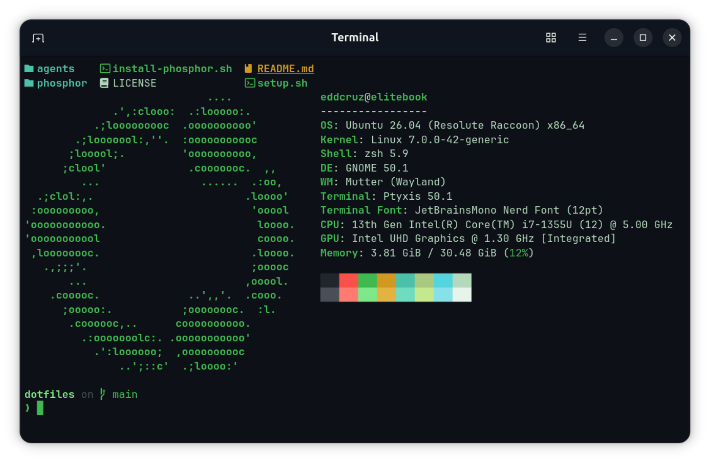

# dotfiles

Reproducible setup for my personal laptop (HP EliteBook 840 G10 · Ubuntu 26.04 LTS): a bootstrap script, the **Phosphor** terminal look, and security rules for AI coding agents.



## Why

A fresh install should be one command away from a working, private, good-looking machine — not an afternoon of copy-pasting commands from old notes.

## Quick start (fresh install)

```bash
sudo apt install -y git
git clone https://github.com/eddcruz/dotfiles.git ~/dev/dotfiles
cd ~/dev/dotfiles
./setup.sh              # base system: privacy, tools, agents
./install-phosphor.sh   # look and feel
```

Then restore the agent security rules:

```bash
cp agents/claude-settings.json ~/.claude/settings.json
mkdir -p ~/.codex && cp agents/codex-config.toml ~/.codex/config.toml
```

Antigravity (Gemini) is configured by hand: see `agents/antigravity-rules.md`.

> **Privacy tip:** when `setup.sh` asks for your Git email, use your GitHub noreply address
> (github.com/settings/emails) so your real email never lands in public commits.

## What's inside

| Path | What it does |
|---|---|
| `setup.sh` | 10-step base install: no Snap, masked telemetry, firewall, Docker, VS Code, Zsh, Claude Code, Codex |
| `install-phosphor.sh` | Nerd Font, terminal palette, Starship prompt, btop, fastfetch and wallpaper |
| `phosphor/` | Theme files for each tool |
| `agents/` | Security rules for AI coding agents: block reads of `~/.ssh`, `.env` files and other agents' credentials |

## AI agent security

Three agents work on the same machine (Claude Code, Codex, Gemini via Antigravity), so each one is locked down the same way:

| Agent | Writes and commands | Denied reads | Verified by |
|---|---|---|---|
| Claude Code | Manual approval | 8 rules | Explicit denial on a test `.env` |
| Codex | Read-only profile, ask for approval | 6 rules | `codex sandbox` test with a control file |
| Gemini (Antigravity) | Require review + sandbox | 6 rules | Never returned a denied file (indirect) |

Rules are only trusted after a test: ask the agent to read a decoy file and confirm it is blocked — with a control file that should be readable, so a broken config can't pass as a working one.

## Phosphor palette

| Role | Color |
|---|---|
| Background | `#0d1117` |
| Text | `#b5d8bc` |
| Green | `#3fb950` |
| Bright green | `#7ee787` |
| Cyan | `#56d4dd` |
| Amber | `#d29922` |
| Red | `#f85149` |

## Repo rule

No secrets, ever: no keys, tokens, passwords or `.env` files.
